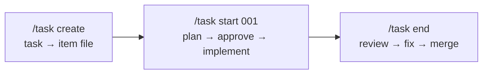
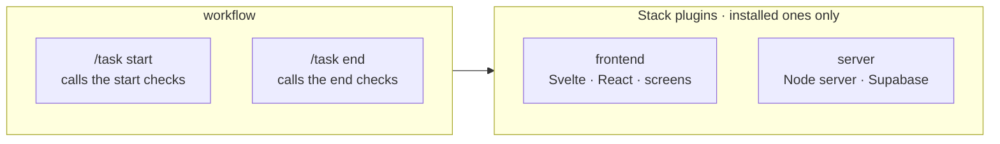

# j-dev-kit

[한국어](README.md) | **English**

> Translation of README.md. The Korean README is the source.

A set of Claude Code plugins that runs the whole loop — turn a task into a backlog item, implement it, review it, and merge — with a single `/task`.



No need to memorize the commands. Say "put this in the backlog" or "start 001" and Claude invokes it on its own.

## Plugins

| Plugin | What it does | Also installs |
| --- | --- | --- |
| `workflow` | The `/task` loop and the verify hook (required) | `superpowers` |
| `frontend` | Svelte and React checks, screen mockups and review, browser verification | `workflow`, `typescript-lsp`, `frontend-design` |
| `server` | Node server and Supabase checks and review | `workflow` |

Install only the stacks you use. If you use Supabase, install `server` even if you only call it from the frontend.

## Stacks

`workflow` runs the same loop in every project. The checks that differ per project (framework rules, migrations, screen verification) belong to stack plugins. `/task start` and `/task end` call the checks of every installed stack plugin. Each check runs only when the item touches its area; otherwise it drops out as "not applicable".



| Stack | Runs when | In `/task start` | In `/task end` |
| --- | --- | --- | --- |
| frontend | package.json has a framework such as react or svelte | Gives the framework rules. Makes mockups for a new screen. Verifies in the browser when the UI changes | Checks for leftover debug code and the lockfile. `frontend-reviewer` reviews, and `design-reviewer` too when a screen changed |
| server | There are Node server dependencies or Supabase | Gives the transaction and migration rules. Blocks commands that change a remote database | Checks for missing migrations and config keys. `api-reviewer` and `supabase-reviewer` review |

The `stack:` line in CLAUDE.md sets which stacks run (for example `stack: frontend, server`). Without the line, installed stack plugins decide from the code.

## Quick start

**1. Install**

```bash
claude plugin marketplace add JiHoon777/j-dev-kit --scope project
claude plugin install frontend@j-dev-kit --scope project
claude plugin install server@j-dev-kit --scope project
```

Do not remove the dependency plugin lines written to `.claude/settings.json`.

**2. Add settings to the project CLAUDE.md**

```markdown
## Work settings
- stack: frontend, server
- base branch: main
- verify command: pnpm verify
- document language: English

## superpowers
The rules in this document take precedence. Follow only the skills `/task` calls; do not use
writing-plans, executing-plans, subagent-driven-development, or using-git-worktrees.
```

For `stack:`, see [Stacks](#stacks) above. Without the superpowers paragraph, superpowers takes over the planning step of `/task start`.

**3. Use it**

```
/task create Add a login screen   # make the item docs/backlog/001-….md
/task start 001                   # in a new session: plan → approve → implement
/task end                         # in that session: review → fix → merge
```

## More

<details>
<summary>What /task does</summary>

```
/task start 001 --here                              # in this session, no sub-session
/task create --survey Reduce frequent errors logs/  # research the repo and the outside, show item candidates as a report
```

- **Sub-sessions:** `create` and `start` open a session and only report its link. `start` runs in a new worktree off the base branch (on a `w/<item>` branch). The sub-session's questions and approval requests are shown in the starting session, which passes on the answers and, when the sub-session finishes, checks the result and reports first. Plan approval happens on the sub-session's plan screen. Where sessions cannot be opened (outside the desktop app), the work happens in this session. To run several items together, call `start` several times.
- **create --survey:** splits the goal into research questions and researches the repository and the outside (official docs, issues, precedents, practitioners' writing) with subagents in parallel. It shows the candidates a judge agent filtered, together with a report, and writes only the ones picked. The report is committed to `docs/backlog/references/`. To leave out the outside, `--internal`.
- **start:** baseline verification → stack checks → planning sized to the item → test-first implementation → cleanup (`simplify`) → verification. Acceptance Criteria are checked off only with command output or a judge agent other than the implementing session. If the same AC still fails after three fixes, it stops and hands over.
- **end:** stack checks → review (`code-review`, plus `security-review` and stack reviewers when needed) → a judge agent picks the valid findings, shown as 🔴 must fix / 🟡 consider / ⚪ minor with a question → fixes → verification → merge. Pushes only on request. A new test that passes without the fixed code is flagged as 🟡.
- **Review principles:** findings left as is and what the user corrected are collected as one-line principles in `docs/review-principles.md` and used in later reviews.

</details>

<details>
<summary>What runs on its own (verify hook, ports, worktrees, design)</summary>

- **Verify hook:** on a `w/` branch, when the item's Definition of Done is checked and Claude stops, it runs the `verify command:` from the base branch's CLAUDE.md. On failure it sends Claude back with the output. It does not run again while the code is unchanged. It waits up to 30 minutes. On Windows it needs Git Bash.
- **Ports:** with `- 웹 포트: 5000` (web port) and `- 서버 포트: 6000` (server port) under `## 작업 설정` (work settings) in CLAUDE.md, each item uses `base port + item number` (item 007 → 5007, 6007). Ports in use are skipped by going up by 1. If you work on several projects together, keep base ports 1000 apart per project (for example A on 5000 and 6000, B on 7000 and 8000).
- **Worktrees:** if a worktree is created inside the repository (for example `.claude/worktrees/`), leave that folder out of test and lint settings. Archiving the session after the merge lets the app clean up the worktree.
- **Browser check (frontend):** when the UI changes, the `frontend-evaluator` agent, not the implementing session, judges each AC on the running screen.
- **Design (frontend):** for an item that adds or redesigns a screen, `start` makes mockups on the design canvas before planning and writes the chosen one into the plan. For a UI item with no `DESIGN.md`, it asks whether to make one (to opt out, `- DESIGN.md: 안 씀`). Saying "make mockups for the login screen" without an item also runs `ui-design`.

</details>

<details>
<summary>Nice-to-have plugins</summary>

| Plugin / skill | Install |
| --- | --- |
| Official Svelte | `/plugin marketplace add sveltejs/ai-tools`, `/plugin install svelte@svelte` |
| Chrome DevTools | `/plugin marketplace add ChromeDevTools/chrome-devtools-mcp`, `/plugin install chrome-devtools-mcp@chrome-devtools-plugins` |
| modern-web-guidance | `/plugin marketplace add GoogleChrome/modern-web-guidance`, `/plugin install modern-web-guidance@googlechrome` |
| React (Vercel react-best-practices, composition-patterns) | `npx -y skills@1.7.5 add vercel-labs/agent-skills --skill vercel-react-best-practices --skill vercel-composition-patterns -a claude-code` |
| React Router | `npx -y skills@1.7.5 add https://github.com/remix-run/react-router --skill react-router -a claude-code` |
| Next.js docs | On 16.3 or later `next dev` writes `AGENTS.md`. Below that, `npx @next/codemod@canary agents-md` |
| Official Supabase | `/plugin install supabase@anthropic-plugin-directory` (turn off its bundled MCP in `/mcp`) |

</details>

<details>
<summary>Troubleshooting</summary>

| Symptom | Fix |
| --- | --- |
| `supabase@j-dev-kit` cannot be found | It was merged into `server`. Remove it from `enabledPlugins` and install `server@j-dev-kit`. |
| `architecture@j-dev-kit` or `design@j-dev-kit` cannot be found | They were removed. Remove them from `enabledPlugins`. DESIGN.md and mockups moved to `ui-design` in `frontend`, and screen review to `design-reviewer` in `frontend`. |
| `Dependency "…" is not installed` | Install the removed dependency plugin with the same `--scope`. |
| The verify command runs when Claude stops | That is the verify hook. It runs only when the item's Definition of Done is checked and the code changed since the last pass. Without a `verify command:` line in CLAUDE.md it does not run. |
| No stack checks run | The plugin is disabled, or it is missing from `stack:` in CLAUDE.md. |

</details>

<details>
<summary>Updating and contributing</summary>

```bash
claude plugin marketplace update j-dev-kit
claude plugin update <plugin>@j-dev-kit --scope project
```

Then open a new session. If a plugin's `version` is unchanged, the update is not picked up.

```
plugins/workflow/skills/task/       SKILL.md + references/create.md, start.md, end.md + scripts/pick-port.sh, base-tests.sh
plugins/workflow/hooks/             hooks.json, verify-on-stop.sh (Stop hook)
plugins/frontend/                   skills/frontend-{start,end}-check (scripts/dev-server.sh, diff-check.sh), ui-design, agents/frontend-reviewer.md, design-reviewer.md, frontend-evaluator.md
plugins/server/                     skills/server-{start,end}-check (scripts/config-check.sh), agents/api-reviewer.md, supabase-reviewer.md
i18n/en/                            English translations (Claude does not read them)
scripts/check-repo-rules.sh         repository rule check
scripts/test-*.sh                   scenario tests for the check script, the verify hook and the plugin scripts
```

- The source is Korean (`plugins/`); translations live in `i18n/en/`. Update the translation when you change the source.
- To add a stack, make a plugin with `<stack>-start-check` and `<stack>-end-check` skills and register it in `marketplace.json`. `/task` finds and calls them by those names.
- Bump `version` in the changed plugin's `plugin.json`, run the verify command (`claude plugin validate . && bash scripts/check-repo-rules.sh`), then push.
- The check script fails when: a translation is missing or only the source changed; a plugin's description differs between `plugin.json` and `marketplace.json`; a plugin is missing from the table in either README; a changed plugin kept or lowered its `version`; the `port_open` bodies in `pick-port.sh` and `dev-server.sh` differ; or a script changed since `main` has no paired test `scripts/test-<name>.sh` or that test fails. A test that runs past `CHECK_TESTS_TIMEOUT` seconds (default 540) is stopped and fails.

</details>

<details>
<summary>Sources</summary>

[Backlog.md](https://github.com/MrLesk/Backlog.md) item format, [superpowers](https://github.com/obra/superpowers) (brainstorming, TDD, verification before completion, receiving review, finishing a branch), [spec-kit](https://github.com/github/spec-kit) (at most 3 questions), [compound-engineering](https://github.com/EveryInc/compound-engineering-plugin) (planning sized to the task), [andrej-karpathy-skills](https://github.com/multica-ai/andrej-karpathy-skills), Claude Code built-in `code-review`, `security-review`, `simplify`, OWASP API Security Top 10, [supabase/agent-skills](https://github.com/supabase/agent-skills), Anthropic [Skill authoring best practices](https://platform.claude.com/docs/en/agents-and-tools/agent-skills/best-practices).

Verify hook, `frontend-evaluator`, `design-reviewer`: Claude Code [hooks](https://code.claude.com/docs/en/hooks.md) (rules that must hold go in hooks, not instructions), Anthropic [harness design](https://www.anthropic.com/engineering/harness-design-long-running-apps) (an evaluator kept apart from the builder uses the running app itself).

Practitioners' tools and steps, outside judging, review principles, trimming with evals, survey: the Felix Rieseberg talk ([video](https://youtu.be/D-SVFneJ_Nk)), Lauren Tan ([video](https://www.youtube.com/watch?v=MN9dGgmLyso), grouping related reports and reproducing them), Satya Nadella ([video](https://www.youtube.com/watch?v=0NE89Nzfk20), keep evals and re-measure when the model changes). How the survey researches: Anthropic [multi-agent research system](https://www.anthropic.com/engineering/multi-agent-research-system) (parallel gathering per angle, primary sources), Hamel Husain [error analysis](https://hamel.dev/blog/posts/evals-faq/why-is-error-analysis-so-important-in-llm-evals-and-how-is-it-performed.html) (notes → categories → counts → saturation), Teresa Torres [opportunity solution trees](https://www.producttalk.org/ai-opportunity-solution-trees/) (candidates as problems or needs), Claude Code `/dedupe` (filtering separately).

`ui-design` and `design-reviewer`: [Google DESIGN.md](https://github.com/google-labs-code/design.md), WCAG 2.2, Claude Code [artifacts](https://code.claude.com/docs/en/artifacts.md). Ideas borrowed from: [emilkowalski/skills](https://github.com/emilkowalski/skills) `prototype` (name and axis, 3–5 mockups, stop until the user picks), [impeccable](https://github.com/pbakaus/impeccable) (axis list, identity lock), [gstack](https://github.com/garrytan/gstack) `design-shotgun` (headline swap test), [OneRedOak/claude-code-workflows](https://github.com/OneRedOak/claude-code-workflows) `design-review` (live review per width).

</details>
