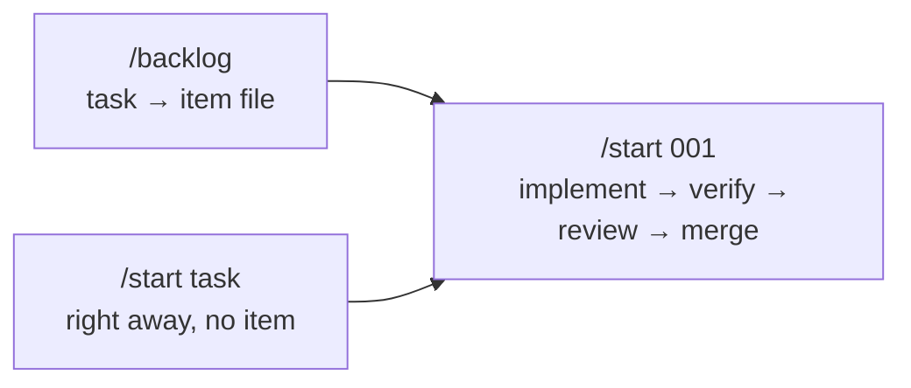
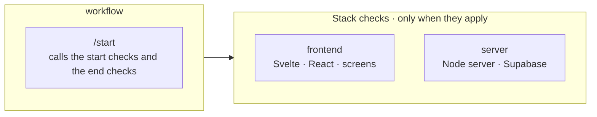

# j-dev-kit

[한국어](README.md) | **English**

> Translation of README.md. The Korean README is the source.

A Claude Code plugin that turns a task into a backlog item (`/backlog`) and then implements it, reviews it, and merges it (`/start`). It asks only what is truly needed, and for the rest it goes to the end while writing what it decided and why into the item file.



No need to memorize the commands. Say "put this in the backlog" or "start 001" and Claude invokes it on its own. If you want to know how to use it, ask `/kit-help`.

## Plugins

| Plugin | What it does |
| --- | --- |
| `workflow` | The `/backlog` and `/start` loop, stack checks (frontend, server), principles, skills and playbooks, model settings, and the verify hook |

There is one plugin. It has no dependency plugins. Stack checks run only when they apply to the project.

## Stacks

`workflow` runs the same loop in every project. The checks that differ per project (framework rules, migrations, screen verification) belong to stack check skills. `/start` calls every stack check. It calls the start checks before implementation and the end checks before the review. Each check runs only when the item touches its area; otherwise it drops out as "not applicable".



| Stack | Runs when | Start check | End check |
| --- | --- | --- | --- |
| frontend | package.json has a framework such as react or svelte | Gives the framework rules. Makes mockups for a new screen. Verifies in the browser when the UI changes | Checks for leftover debug code and the lockfile. `frontend-reviewer` reviews, and `design-reviewer` too when a screen changed |
| server | There are Node server dependencies or Supabase | Gives the transaction and migration rules. Blocks commands that change a remote database | Checks for missing migrations and config keys. `api-reviewer` and `supabase-reviewer` review |

The `stack:` line in CLAUDE.md sets which stacks run (for example `stack: frontend, server`, or `stack: 없음` (none) if there are none). Without the line, the checks decide from the code. Supabase is covered by the server check even if you only call it from the frontend.

## Quick start

**1. Install**

```bash
claude plugin marketplace add JiHoon777/j-dev-kit --scope project
claude plugin install workflow@j-dev-kit --scope project
```

**2. Set up**

```
/kit-setup
```

It asks which model and effort each role uses and how to merge, and writes them to `.claude/workflow.json`. If the project CLAUDE.md has no work settings, it finds them and asks whether to add them. You can also write them yourself.

```markdown
## Work settings
- stack: frontend, server
- base branch: main
- verify command: pnpm verify
- document language: English
```

For `stack:`, see [Stacks](#stacks) above. The superpowers plugin is not used. If it is on, turn it off. Left on, superpowers cuts into the planning step.

**3. Use it**

```
/backlog Add a login screen               # make the item docs/backlog/001-….md
/start 001                                # in a new session: implement → verify → review → merge
/start Fix the login button label         # right away in this session, no item
/kit-help What do I run before a commit?  # ask how to use it
```

## More

<details>
<summary>What /backlog and /start do</summary>

```
/start 001 --here                              # in this session, no sub-session
/backlog --survey Reduce frequent errors logs/  # research the repo and the outside, show item candidates as a report
```

- **What it asks:** only five things. Work that cannot be undone or that goes outside (merging, pushing to the base or a deploy branch, deleting, a remote DB, deploying), work that changes something outside the project or shared settings, product or taste decisions that code or a run cannot settle, choosing what to do, and states that could lose work. It decides the rest and writes it into the item file as `decision — reason — cost if wrong`. It does not get the plan approved. If you say "let me see the plan", it shows the plan and waits.
- **Sub-sessions:** `/backlog` and `/start` open a session and only report its link. `/start` runs in a new worktree off the base branch (on a `w/<item>` branch). The sub-session's questions are shown in the starting session, which passes on the answers and, when the sub-session finishes, checks the result and reports first. Where sessions cannot be opened (outside the desktop app), the work happens in this session. To run several items together, call `/start` several times.
- **/start <task>:** given words that are not a backlog item, it does not create an item and does the work right away in this session. In the first message it restates the goal, the smallest change, and the condition for calling it done, then goes on. Verification and the last message are the same, and the review is sized to the change.
- **/backlog:** shows the full Acceptance Criteria of the item draft and gets approval. It is the only contract a person checks before implementation.
- **/backlog --survey:** splits the goal into research questions and researches the repository and the outside (official docs, issues, precedents, practitioners' writing) with subagents in parallel. The collector agent has only read and web tools and note writing; the judge agent has only read and web tools. It shows the candidates a judge agent filtered, together with draft ACs, and writes only the ones picked. The report is committed to `docs/backlog/references/`. To leave out the outside, `--internal`.
- **/start:** baseline verification → stack checks → restating the goal and picking a playbook → pre-start questions (once, only when there are any) → implementation → cleanup (deslop) → verification → AC judgment → review (`code-review`, plus `security-review` and stack reviewers when needed) → fixing, without asking, the 🔴 and 🟡 findings the judge agent found valid → one last message → merge. Called on a work branch that already exists, it continues from the step that remains.
- **Last message:** asks every remaining decision at once: the findings for a person to decide, the "later" candidates, and how to merge. Each decision comes with a recommendation, the evidence, and the risk. The base branch is pushed only on request.
- **Judgment:** Acceptance Criteria are checked off only with command output or a judge agent other than the implementing session. If the same AC still fails after three fixes, it stops and hands over. A new test that passes without the fixed code is flagged as 🟡.
- **Running to the end:** say "run it to the end" or "I'm stepping away" and it does not stop. It asks only about the merge and work that cannot be undone, decides the other questions by its recommendation, and collects them in the last message.
- **Subagent rules:** every time an agent is launched, the first line of its brief has it read the rules file (`start/references/worker.md`). The bar in the brief is the whole bar, the agent does not ask a person, and it reports what it chose and why.
- **Principles, skills, playbooks:** the `start` skill has a "when → what" index, and each body is its own skill, read when it is used. They do not fire on their own, and you can invoke them directly, as in `/architect`, `/how` or `/deslop`. There are 24 principles, 16 skills (architect, figure-it-out, blast-radius, how, why, creating a verification skill, control-ui, deslop, no-comments and others), and 7 playbooks (investigation, feature, bug-fix, refactoring, prototype, perf-issue, hillclimb). For an item no playbook fits, figure-it-out designs the steps for that work. They were brought in from [pstack](https://github.com/cursor/plugins/tree/main/pstack) and [cursor-team-kit](https://github.com/cursor/plugins/tree/main/cursor-team-kit).
- **Merge setting:** written as `merge` in `.claude/workflow.json` (project) or `~/.claude/workflow.json` (user). `local` merges into the base branch locally and pushes. `pr` opens a PR that targets the base branch. `/kit-setup` asks and writes it. Once set, `/start` does not ask how to merge at the end; it asks only whether to merge that way. Without it, `/start` asks how.
- **Model settings:** the model and effort that sub-sessions and subagents use are written per role (`session`, `implement`, `review`, `judge`, `mechanical`, `explore`) in `.claude/workflow.json` (project) or `~/.claude/workflow.json` (user). `/kit-setup` asks and writes them. Without a file, the defaults match pstack's. Every role runs on Opus: sub-sessions, implementation, review, and judging at effort `xhigh`, and mechanical fixes and exploration at `high`. Fable runs only when you name it for the task or Opus has failed the same brief twice. The main session's model is set by `model` and `effortLevel` in the Claude Code settings, and `/kit-setup` can write those keys too.
- **/kit-help:** ask what to use when. It gives the answer and one command line to send, and does not start work.
- **Review principles:** findings left as is and what the user corrected are collected as one-line principles in `docs/review-principles.md` and used in later reviews.

</details>

<details>
<summary>What runs on its own (verify hook, ports, worktrees, design)</summary>

- **Verify hook:** on a `w/` branch, when the item's Definition of Done is checked and Claude stops, it runs the `verify command:` from the base branch's CLAUDE.md. On failure it sends Claude back with the output. It does not run again while the code is unchanged. It waits up to 30 minutes. On Windows it needs Git Bash.
- **Ports:** with `- 웹 포트: 5000` (web port) and `- 서버 포트: 6000` (server port) under `## 작업 설정` (work settings) in CLAUDE.md, each item uses `base port + item number` (item 007 → 5007, 6007). Ports in use are skipped by going up by 1. If you work on several projects together, keep base ports 1000 apart per project (for example A on 5000 and 6000, B on 7000 and 8000).
- **Worktrees:** if a worktree is created inside the repository (for example `.claude/worktrees/`), leave that folder out of test and lint settings. Archiving the session after the merge lets the app clean up the worktree.
- **Browser check (frontend):** when the UI changes, the `frontend-evaluator` agent, not the implementing session, judges each AC on the running screen.
- **Verification skill and feature map:** if the project has no set way to drive the real app and check it, `/start` asks once per project whether to create the project skill `verify-<app>` (launch, check, drive, evidence, cleanup, and a feature map). When there is one, the screen check and the AC judgment follow that map.
- **Design (frontend):** for an item that adds or redesigns a screen, `/start` makes 3 mockups on the design canvas before planning and writes the chosen one into the plan. For a UI item with no `DESIGN.md`, it asks whether to make one (to opt out, `- DESIGN.md: 안 씀`). Saying "make mockups for the login screen" without an item also runs `ui-design`.

</details>

<details>
<summary>Nice-to-have plugins</summary>

| Plugin / skill | Install |
| --- | --- |
| frontend-design (invoked when designing a new screen) | `/plugin install frontend-design@anthropic-plugin-directory` |
| typescript-lsp | `/plugin install typescript-lsp@anthropic-plugin-directory` |
| Official Svelte | `/plugin marketplace add sveltejs/ai-tools`, `/plugin install svelte@svelte` |
| Chrome DevTools | `/plugin marketplace add ChromeDevTools/chrome-devtools-mcp`, `/plugin install chrome-devtools-mcp@chrome-devtools-plugins` |
| modern-web-guidance | `/plugin marketplace add GoogleChrome/modern-web-guidance`, `/plugin install modern-web-guidance@googlechrome` |
| React (Vercel react-best-practices, composition-patterns) | `npx -y skills@1.7.5 add vercel-labs/agent-skills --skill vercel-react-best-practices --skill vercel-composition-patterns -a claude-code` |
| React Router | `npx -y skills@1.7.5 add https://github.com/remix-run/react-router --skill react-router -a claude-code` |
| Next.js docs | On 16.3 or later `next dev` writes `AGENTS.md`. Below that, `npx @next/codemod@canary agents-md` |
| Official Supabase | `/plugin install supabase@anthropic-plugin-directory` (turn off its bundled MCP in `/mcp`) |

</details>

<details>
<summary>Troubleshooting</summary>

| Symptom | Fix |
| --- | --- |
| `/task` cannot be found | It was split in two. Creating an item is `/backlog`, and implementation through to the merge is `/start`. `/start` also carries on with the review and the merge. |
| `frontend@j-dev-kit` or `server@j-dev-kit` cannot be found | They were merged into `workflow`. Remove the two lines from `enabledPlugins` in the project's `.claude/settings.json` and update `workflow`. Agent names changed to the form `workflow:frontend-reviewer`. |
| superpowers cuts into the plan | It is no longer used. Turn off the `superpowers` plugin and delete the `## superpowers` paragraph from CLAUDE.md. |
| `supabase@j-dev-kit`, `architecture@j-dev-kit`, or `design@j-dev-kit` cannot be found | All were merged into `workflow` or removed. Remove them from `enabledPlugins`. Supabase checks are done by `server-start-check` and `server-end-check`, DESIGN.md and mockups by `ui-design`, and screen review by `design-reviewer`. |
| The verify command runs when Claude stops | That is the verify hook. It runs only when the item's Definition of Done is checked and the code changed since the last pass. Without a `verify command:` line in CLAUDE.md it does not run. |
| No stack checks run | That stack is missing from `stack:` in CLAUDE.md (`stack: 없음`, none), or the code has no framework. |

</details>

<details>
<summary>Updating and contributing</summary>

```bash
claude plugin marketplace update j-dev-kit
claude plugin update workflow@j-dev-kit --scope project
```

Then open a new session. If a plugin's `version` is unchanged, the update is not picked up.

```
plugins/workflow/skills/backlog/    SKILL.md + references/survey.md + scripts/next-number.sh
plugins/workflow/skills/start/      SKILL.md (asking criteria, index) + references/procedure.md, worker.md + playbooks/ (7) + scripts/pick-port.sh, base-tests.sh
plugins/workflow/skills/<skill>/    the 16 skills the index points to (architect, how, why, deslop and more). You can also invoke them directly (`/architect`)
plugins/workflow/skills/principle-*/  the 24 principles
plugins/workflow/THIRD_PARTY_NOTICES.md  copyright notices for the imported texts (pstack, cursor-team-kit)
plugins/workflow/skills/kit-setup/, kit-help/   setup and help
plugins/workflow/skills/frontend-{start,end}-check/ (scripts/dev-server.sh, diff-check.sh), ui-design/   frontend checks and mockups
plugins/workflow/skills/server-{start,end}-check/ (scripts/config-check.sh)   server and Supabase checks
plugins/workflow/agents/            frontend-reviewer.md, design-reviewer.md, frontend-evaluator.md, api-reviewer.md, supabase-reviewer.md, survey-collector.md, survey-judge.md, comment-sicko.md
plugins/workflow/hooks/             hooks.json, verify-on-stop.sh (Stop hook)
plugins/workflow/evals/             eval cases (including the frontend and server reviewer cases)
i18n/en/                            English translations (Claude does not read them)
scripts/check-repo-rules.sh         repository rule check
scripts/test-*.sh                   scenario tests for the check script, the verify hook and the plugin scripts
```

- The source is Korean (`plugins/`); translations live in `i18n/en/`. Update the translation when you change the source.
- To add a stack, add `<stack>-start-check` and `<stack>-end-check` skills under `plugins/workflow/skills/`. `start` also finds and calls skills that another plugin provides under the same naming rule.
- Bump `version` in the changed plugin's `plugin.json`, run the verify command (`claude plugin validate . && bash scripts/check-repo-rules.sh`), then push.
- The check script fails when: a translation is missing or only the source changed; a plugin's description differs between `plugin.json` and `marketplace.json`; a plugin is missing from the table in either README; a changed plugin kept or lowered its `version`; the `port_open` bodies in `pick-port.sh` and `dev-server.sh` differ; or a script changed since `main` has no paired test `scripts/test-<name>.sh` or that test fails. A test that runs past `CHECK_TESTS_TIMEOUT` seconds (default 540) is stopped and fails.

</details>

<details>
<summary>Sources</summary>

[Backlog.md](https://github.com/MrLesk/Backlog.md) item format, [pstack](https://github.com/cursor/plugins/tree/main/pstack) (asking criteria, the shape of the index, 24 principles, skills and playbooks, the last-message format, test rules), [cursor-team-kit](https://github.com/cursor/plugins/tree/main/cursor-team-kit) (control-ui, control-cli, deslop, verify-this, fix-merge-conflicts), [spec-kit](https://github.com/github/spec-kit) (at most 3 questions), [compound-engineering](https://github.com/EveryInc/compound-engineering-plugin) (planning sized to the task), [andrej-karpathy-skills](https://github.com/multica-ai/andrej-karpathy-skills), Claude Code built-in `code-review`, `security-review`, OWASP API Security Top 10, [supabase/agent-skills](https://github.com/supabase/agent-skills), Anthropic [Skill authoring best practices](https://platform.claude.com/docs/en/agents-and-tools/agent-skills/best-practices).

Verify hook, `frontend-evaluator`, `design-reviewer`: Claude Code [hooks](https://code.claude.com/docs/en/hooks.md) (rules that must hold go in hooks, not instructions), Anthropic [harness design](https://www.anthropic.com/engineering/harness-design-long-running-apps) (an evaluator kept apart from the builder uses the running app itself).

Practitioners' tools and steps, outside judging, review principles, trimming with evals, survey: the Felix Rieseberg talk ([video](https://youtu.be/D-SVFneJ_Nk)), Lauren Tan ([video](https://www.youtube.com/watch?v=MN9dGgmLyso), grouping related reports and reproducing them), Satya Nadella ([video](https://www.youtube.com/watch?v=0NE89Nzfk20), keep evals and re-measure when the model changes). How the survey researches: Anthropic [multi-agent research system](https://www.anthropic.com/engineering/multi-agent-research-system) (parallel gathering per angle, primary sources), Hamel Husain [error analysis](https://hamel.dev/blog/posts/evals-faq/why-is-error-analysis-so-important-in-llm-evals-and-how-is-it-performed.html) (notes → categories → counts → saturation), Teresa Torres [opportunity solution trees](https://www.producttalk.org/ai-opportunity-solution-trees/) (candidates as problems or needs), Claude Code `/dedupe` (filtering separately).

`ui-design` and `design-reviewer`: [Google DESIGN.md](https://github.com/google-labs-code/design.md), WCAG 2.2, Claude Code [artifacts](https://code.claude.com/docs/en/artifacts.md). Ideas borrowed from: [emilkowalski/skills](https://github.com/emilkowalski/skills) `prototype` (name and axis, 3–5 mockups, stop until the user picks), [impeccable](https://github.com/pbakaus/impeccable) (axis list, identity lock), [gstack](https://github.com/garrytan/gstack) `design-shotgun` (headline swap test), [OneRedOak/claude-code-workflows](https://github.com/OneRedOak/claude-code-workflows) `design-review` (live review per width).

</details>
