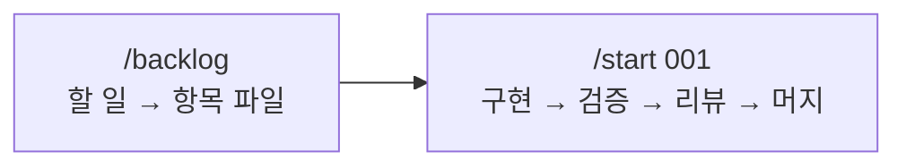
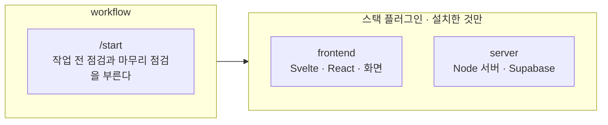

# j-dev-kit

**한국어** | [English](README.en.md)

할 일을 백로그 항목으로 만들고(`/backlog`), 구현하고 리뷰해서 머지하기까지(`/start`) 돌리는 Claude Code 플러그인 모음. 꼭 필요한 것만 묻고, 나머지는 정한 것과 이유를 항목 파일에 적으면서 끝까지 간다.



명령을 외울 필요는 없다. "백로그에 넣어 줘", "001 시작해 줘"라고 말하면 Claude 가 알아서 부른다.

## 플러그인

| 플러그인 | 하는 일 | 같이 설치되는 것 |
| --- | --- | --- |
| `workflow` | `/backlog`·`/start` 흐름과 검증 훅 (필수) | 없음 |
| `frontend` | Svelte·React 점검, 화면 시안과 리뷰, 브라우저 확인 | `workflow`, `typescript-lsp`, `frontend-design` |
| `server` | Node 서버·Supabase 점검과 리뷰 | `workflow` |

쓰는 스택만 설치한다. Supabase 를 쓰면 프론트엔드에서만 부르더라도 `server`를 설치한다.

## 스택

`workflow`는 어느 프로젝트에서나 같은 흐름을 돌린다. 프로젝트마다 다른 점검(프레임워크 규칙, 마이그레이션, 화면 확인)은 스택 플러그인이 맡는다. `/start`는 설치된 스택 플러그인의 점검을 모두 부른다. 구현 전에 작업 전 점검을, 리뷰 전에 마무리 점검을 부른다. 각 점검은 이번 항목이 자기 영역을 건드릴 때만 돌고, 아니면 "해당 없음"으로 빠진다.



| 스택 | 이럴 때 돈다 | 작업 전 점검 | 마무리 점검 |
| --- | --- | --- | --- |
| frontend | package.json 에 react, svelte 같은 프레임워크가 있을 때 | 프레임워크 규칙을 알려 준다. 새 화면이면 시안을 만든다. UI 가 바뀌면 브라우저로 확인한다 | 남은 디버그 코드와 lockfile 을 검사한다. `frontend-reviewer`가 리뷰하고, 화면이 바뀌면 `design-reviewer`도 리뷰한다 |
| server | Node 서버 의존성이나 Supabase 가 있을 때 | 트랜잭션과 마이그레이션 규칙을 알려 준다. 원격 DB 를 바꾸는 명령은 막는다 | 빠진 마이그레이션과 설정 키를 검사한다. `api-reviewer`와 `supabase-reviewer`가 리뷰한다 |

CLAUDE.md 의 `stack:` 줄로 돌릴 스택을 정한다(예: `stack: frontend, server`). 줄이 없으면 설치된 스택 플러그인이 코드를 보고 알아서 정한다.

## 빠른 시작

**1. 설치**

```bash
claude plugin marketplace add JiHoon777/j-dev-kit --scope project
claude plugin install frontend@j-dev-kit --scope project
claude plugin install server@j-dev-kit --scope project
```

`.claude/settings.json`에 적힌 의존 플러그인 줄은 지우지 않는다.

**2. 프로젝트 CLAUDE.md 에 설정 적기**

```markdown
## 작업 설정
- stack: frontend, server
- 기준 브랜치: main
- 검증 명령: pnpm verify
- 문서 언어: 한국어
```

`stack:`은 위 [스택](#스택)을 본다. superpowers 플러그인은 쓰지 않는다. 켜져 있으면 끈다. 켜 두면 superpowers 가 계획 단계에 끼어든다.

**3. 쓰기**

```
/backlog 로그인 화면 추가   # 항목 docs/backlog/001-….md 만들기
/start 001                  # 새 세션에서 구현 → 검증 → 리뷰 → 머지
```

## 더 알아보기

<details>
<summary>/backlog 와 /start 가 하는 일</summary>

```
/start 001 --here                              # 하위 세션 없이 이 세션에서
/backlog --survey 자주 나는 오류 줄이기 logs/  # 저장소와 바깥을 조사해 항목 후보를 보고서로
```

- **묻는 것:** 다섯 가지만 묻는다. 되돌릴 수 없거나 밖으로 나가는 일(머지, 기준·배포 브랜치 푸시, 삭제, 원격 DB, 배포), 프로젝트 밖이나 공유 설정을 바꾸는 일, 코드나 실행으로 정할 수 없는 제품·취향 결정, 무엇을 할지 고르기, 작업을 잃을 수 있는 상태. 나머지는 정하고 항목 파일에 `정한 것 — 이유 — 틀렸을 때 비용`으로 적는다. 계획 승인은 받지 않는다. "계획을 보자"고 하면 보여 주고 기다린다.
- **하위 세션:** `/backlog`와 `/start`는 세션을 하나 띄우고 링크만 알린다. `/start`는 기준 브랜치에서 딴 새 워크트리(`w/<항목>` 브랜치)에서 돈다. 하위 세션의 질문은 띄운 세션에서 보여 주고 답을 전하며, 끝나면 결과를 확인해 먼저 보고한다. 세션을 띄울 수 없는 곳(데스크톱 앱 밖)에서는 이 세션에서 한다. 여러 항목을 함께 하려면 `/start`를 여러 번 부른다.
- **/backlog:** 항목 초안의 Acceptance Criteria 전문을 보여 주고 승인받는다. 구현 전에 사람이 확인하는 유일한 계약이다.
- **/backlog --survey:** 목표를 조사 질문으로 쪼개 저장소와 바깥(공식 문서, 이슈, 선례, 실무자의 글)을 하위 에이전트로 함께 조사한다. 판정 에이전트가 거른 후보를 AC 초안과 함께 보여 주고, 고른 것만 항목으로 쓴다. 보고서는 `docs/backlog/references/`에 커밋한다. 바깥 조사를 빼려면 `--internal`.
- **/start:** 기준선 검증 → 스택 점검 → 목표 되짚기와 플레이북 고르기 → 착수 전 질문(있을 때만 한 번) → 구현 → 정리(deslop) → 검증 → AC 판정 → 리뷰(`code-review`, 필요하면 `security-review`와 스택 리뷰어) → 판정 에이전트가 타당하다고 본 🔴·🟡 는 묻지 않고 고침 → 마지막 메시지 하나 → 머지. 이미 있는 작업 브랜치에서 부르면 남은 단계부터 이어 간다.
- **마지막 메시지:** 남은 결정을 한 번에 묻는다. 사람이 정할 지적, "나중" 후보, 머지 방식. 결정마다 추천, 근거, 위험이 붙는다. 기준 브랜치 푸시는 요청할 때만 한다.
- **판정:** Acceptance Criteria 는 명령 출력이나 구현 세션이 아닌 판정 에이전트가 확인한 것만 체크한다. 같은 AC 가 세 번 고쳐도 실패하면 멈추고 넘긴다. 고친 코드 없이도 통과하는 새 테스트는 🟡 로 지적한다.
- **원칙, 스킬, 플레이북:** `start` 스킬에 "언제 → 무엇" 색인이 있고, 본문은 스킬마다 따로 있어 쓸 때 읽는다. 스스로 뜨지는 않고, `/architect`, `/how`, `/deslop`처럼 직접 부를 수 있다. 원칙 24개, 스킬 15개(architect, figure-it-out, blast-radius, how, why, 검증 스킬 만들기, control-ui, deslop 등), 플레이북 6개(feature, bug-fix, refactoring, prototype, perf-issue, hillclimb)다. 맞는 플레이북이 없는 항목은 figure-it-out 이 그 일에 맞는 단계를 짠다. [pstack](https://github.com/cursor/plugins/tree/main/pstack)과 [cursor-team-kit](https://github.com/cursor/plugins/tree/main/cursor-team-kit)에서 가져왔다.
- **리뷰 원칙:** 그대로 두기로 한 지적과 사용자가 바로잡은 것은 `docs/review-principles.md`에 한 줄 원칙으로 모여 다음 리뷰에 쓰인다.

</details>

<details>
<summary>알아서 도는 것 (검증 훅, 포트, 워크트리, 디자인)</summary>

- **검증 훅:** `w/` 브랜치에서 항목의 Definition of Done 을 체크하고 멈추면, 기준 브랜치 CLAUDE.md 의 `검증 명령:`을 돌린다. 실패하면 출력과 함께 되돌려 보낸다. 코드가 그대로면 다시 돌리지 않는다. 30분까지 기다린다. Windows 에서는 Git Bash 가 필요하다.
- **포트:** CLAUDE.md `## 작업 설정`에 `- 웹 포트: 5000`, `- 서버 포트: 6000`을 두면 항목마다 `기준 포트 + 항목 번호`(항목 007 → 5007, 6007)를 쓴다. 쓰는 중인 포트는 1씩 올려 피한다. 여러 프로젝트를 함께 하면 프로젝트마다 기준 포트를 1000씩 떨어뜨린다(예: A 는 5000·6000, B 는 7000·8000).
- **워크트리:** 워크트리가 저장소 안(예: `.claude/worktrees/`)에 생기면 테스트·린트 설정에서 그 폴더를 뺀다. 머지 뒤 세션을 보관하면 앱이 워크트리를 정리한다.
- **브라우저 확인 (frontend):** UI 가 바뀌면 구현한 세션이 아니라 `frontend-evaluator` 에이전트가 실행 중인 화면에서 AC 를 하나씩 판정한다.
- **검증 스킬과 기능 지도:** 프로젝트에 앱을 실제로 몰아 확인할 정해진 방법이 없으면, `/start`가 프로젝트 스킬 `verify-<앱>`(띄우기, 점검, 몰기, 증거, 정리와 기능 지도)을 만들지 프로젝트당 한 번 묻는다. 있으면 화면 확인과 AC 판정이 그 지도를 따른다.
- **디자인 (frontend):** 새 화면이나 다시 디자인하는 항목이면 `/start`가 계획 전에 디자인 캔버스로 시안 3개를 만들고, 고른 안을 계획에 적는다. UI 항목인데 `DESIGN.md`가 없으면 만들지 묻는다(안 쓰려면 `- DESIGN.md: 안 씀`). 항목 없이 "로그인 화면 시안 만들어 줘"라고 해도 `ui-design`이 돈다.

</details>

<details>
<summary>있으면 좋은 플러그인</summary>

| 플러그인 · 스킬 | 설치 |
| --- | --- |
| Svelte 공식 | `/plugin marketplace add sveltejs/ai-tools`, `/plugin install svelte@svelte` |
| Chrome DevTools | `/plugin marketplace add ChromeDevTools/chrome-devtools-mcp`, `/plugin install chrome-devtools-mcp@chrome-devtools-plugins` |
| modern-web-guidance | `/plugin marketplace add GoogleChrome/modern-web-guidance`, `/plugin install modern-web-guidance@googlechrome` |
| React (Vercel react-best-practices, composition-patterns) | `npx -y skills@1.7.5 add vercel-labs/agent-skills --skill vercel-react-best-practices --skill vercel-composition-patterns -a claude-code` |
| React Router | `npx -y skills@1.7.5 add https://github.com/remix-run/react-router --skill react-router -a claude-code` |
| Next.js 문서 | 16.3 이상은 `next dev`가 `AGENTS.md`를 만든다. 그보다 낮으면 `npx @next/codemod@canary agents-md` |
| Supabase 공식 | `/plugin install supabase@anthropic-plugin-directory` (같이 오는 MCP 는 `/mcp`에서 끈다) |

</details>

<details>
<summary>문제 해결</summary>

| 증상 | 해결 |
| --- | --- |
| `/task`를 찾을 수 없다 | 둘로 나눴다. 항목 만들기는 `/backlog`, 구현부터 머지까지는 `/start`다. 리뷰와 머지도 `/start`가 이어서 한다. |
| superpowers 가 계획에 끼어든다 | 더는 쓰지 않는다. `superpowers` 플러그인을 끄고, CLAUDE.md 의 `## superpowers` 문단을 지운다. |
| `supabase@j-dev-kit`을 찾을 수 없다 | `server`로 합쳤다. `enabledPlugins`에서 지우고 `server@j-dev-kit`을 설치한다. |
| `architecture@j-dev-kit`, `design@j-dev-kit`을 찾을 수 없다 | 지웠다. `enabledPlugins`에서 지운다. DESIGN.md·시안은 `frontend`의 `ui-design`, 화면 리뷰는 `frontend`의 `design-reviewer`로 옮겼다. |
| `Dependency "…" is not installed` | 지워진 의존 플러그인을 같은 `--scope`로 설치한다. |
| 멈출 때 검증 명령이 돈다 | 검증 훅이다. 항목의 Definition of Done 이 체크돼 있고 코드가 마지막 통과 뒤에 바뀌었을 때만 돈다. CLAUDE.md 에 `검증 명령:` 줄이 없으면 돌지 않는다. |
| 스택 점검이 하나도 안 돈다 | 플러그인이 꺼져 있거나 CLAUDE.md 의 `stack:`에 빠져 있다. |

</details>

<details>
<summary>업데이트와 기여</summary>

```bash
claude plugin marketplace update j-dev-kit
claude plugin update <플러그인>@j-dev-kit --scope project
```

그다음 세션을 새로 연다. 플러그인의 `version`이 같으면 업데이트되지 않는다.

```
plugins/workflow/skills/backlog/    SKILL.md + references/survey.md
plugins/workflow/skills/start/      SKILL.md(묻는 기준, 색인) + references/procedure.md + playbooks/(6개) + scripts/pick-port.sh, base-tests.sh
plugins/workflow/skills/<스킬>/     색인이 가리키는 스킬 15개(architect, how, why, deslop 등). 직접 부를 수도 있다(`/architect`)
plugins/workflow/skills/principle-*/  원칙 24개
plugins/workflow/THIRD_PARTY_NOTICES.md  가져온 글의 저작권 고지(pstack, cursor-team-kit)
plugins/workflow/hooks/             hooks.json, verify-on-stop.sh (Stop 훅)
plugins/frontend/                   skills/frontend-{start,end}-check(scripts/dev-server.sh, diff-check.sh), ui-design, agents/frontend-reviewer.md, design-reviewer.md, frontend-evaluator.md
plugins/server/                     skills/server-{start,end}-check(scripts/config-check.sh), agents/api-reviewer.md, supabase-reviewer.md
i18n/en/                            영어 번역본 (Claude 는 읽지 않음)
scripts/check-repo-rules.sh         저장소 규칙 검사
scripts/test-*.sh                   검사 스크립트·검증 훅·플러그인 스크립트의 시나리오 테스트
```

- 원문은 한국어(`plugins/`), 번역본은 `i18n/en/`. 원문을 고치면 번역본도 고친다.
- 새 스택은 `<스택>-start-check`, `<스택>-end-check` 스킬을 가진 플러그인으로 만들어 `marketplace.json`에 등록한다. `start` 스킬이 이 이름으로 찾아 부른다.
- 고친 플러그인의 `plugin.json` `version`을 올리고, 검증 명령(`claude plugin validate . && bash scripts/check-repo-rules.sh`)을 돌린 뒤 푸시한다.
- 검사 스크립트는 이럴 때 실패한다: 번역본이 없거나 원문만 고쳤을 때, `plugin.json`과 `marketplace.json`의 설명이 다를 때, 플러그인이 README 두 개의 표에 없을 때, 바뀐 플러그인의 `version`이 그대로이거나 내려갔을 때, `pick-port.sh`와 `dev-server.sh`의 `port_open` 본문이 다를 때, `main` 대비 바뀐 스크립트의 짝 테스트 `scripts/test-<이름>.sh`가 없거나 틀릴 때. 테스트 하나가 `CHECK_TESTS_TIMEOUT`초(기본 540)를 넘으면 끊고 실패한다.

</details>

<details>
<summary>출처</summary>

[Backlog.md](https://github.com/MrLesk/Backlog.md) 항목 형식, [pstack](https://github.com/cursor/plugins/tree/main/pstack)(묻는 기준, 색인 모양, 원칙 24개, 스킬과 플레이북, 마지막 메시지 형식, 테스트 규칙), [cursor-team-kit](https://github.com/cursor/plugins/tree/main/cursor-team-kit)(control-ui, control-cli, deslop, verify-this, fix-merge-conflicts), [spec-kit](https://github.com/github/spec-kit)(질문 최대 3개), [compound-engineering](https://github.com/EveryInc/compound-engineering-plugin)(크기에 맞춘 계획), [andrej-karpathy-skills](https://github.com/multica-ai/andrej-karpathy-skills), Claude Code 내장 `code-review`·`security-review`·`simplify`, OWASP API Security Top 10, [supabase/agent-skills](https://github.com/supabase/agent-skills), Anthropic [Skill authoring best practices](https://platform.claude.com/docs/en/agents-and-tools/agent-skills/best-practices).

검증 훅, `frontend-evaluator`, `design-reviewer`: Claude Code [hooks](https://code.claude.com/docs/en/hooks.md)(꼭 지킬 것은 지침이 아니라 훅으로), Anthropic [harness design](https://www.anthropic.com/engineering/harness-design-long-running-apps)(만든 쪽과 따로 둔 평가자가 실행 중인 앱을 직접 써 본다).

실무자의 도구·단계, 바깥 판정, 리뷰 원칙, eval 로 덜어내기, 서베이: Felix Rieseberg 대담([영상](https://youtu.be/D-SVFneJ_Nk)), Lauren Tan([영상](https://www.youtube.com/watch?v=MN9dGgmLyso), 관련 제보 묶기·재현), Satya Nadella([영상](https://www.youtube.com/watch?v=0NE89Nzfk20), eval 을 남겨 모델이 바뀌면 다시 재기). 서베이의 조사 방식: Anthropic [multi-agent research system](https://www.anthropic.com/engineering/multi-agent-research-system)(각도별 병렬 수집, 1차 출처), Hamel Husain [error analysis](https://hamel.dev/blog/posts/evals-faq/why-is-error-analysis-so-important-in-llm-evals-and-how-is-it-performed.html)(메모 → 범주 → 세기 → 포화), Teresa Torres [opportunity solution trees](https://www.producttalk.org/ai-opportunity-solution-trees/)(후보는 문제·필요로), Claude Code `/dedupe`(따로 거르기).

`ui-design`·`design-reviewer`: [Google DESIGN.md](https://github.com/google-labs-code/design.md), WCAG 2.2, Claude Code [artifacts](https://code.claude.com/docs/en/artifacts.md). 아이디어를 빌린 스킬: [emilkowalski/skills](https://github.com/emilkowalski/skills) `prototype`(이름과 축, 3~5개, 고를 때까지 멈춤), [impeccable](https://github.com/pbakaus/impeccable)(축 목록, 정체성 고정), [gstack](https://github.com/garrytan/gstack) `design-shotgun`(헤드라인 바꾸기 테스트), [OneRedOak/claude-code-workflows](https://github.com/OneRedOak/claude-code-workflows) `design-review`(폭별 실제 화면 리뷰).

</details>
